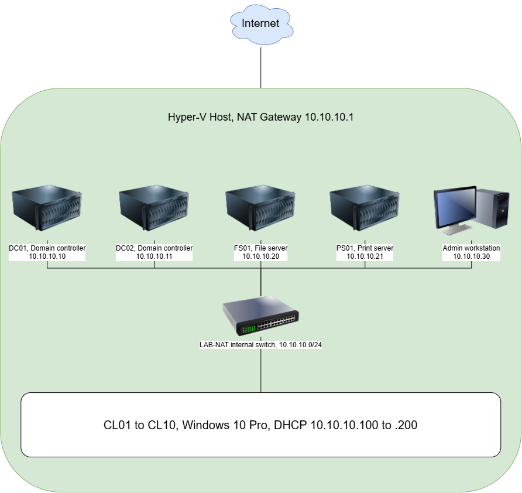

# Meridian Dynamics Homelab: Windows Server Active Directory Environment

A fully documented on-premises Windows Server environment built on Hyper-V to practice systems
administration: identity, Group Policy, file and print services, endpoint security, backup and
recovery, and troubleshooting. Every phase is written up with commands, screenshots, and the
problems I hit along the way.

## The environment
| Component | Details |
| --- | --- |
| Domain | `corp.meridian.lab`, two domain controllers (AD DS, DNS), DHCP failover |
| Directory | Six departments, a nested OU structure, 30 users created from a CSV, role-based groups (AGDLP) |
| File services | FS01 and FS02 with DFS Replication, department shares, home folders, FSRM quotas and file screens, shadow copies, and a DFS namespace served by both servers |
| Print services | PS01 with seven access-controlled printer queues |
| Endpoints | Ten Windows 10 Pro clients and an admin workstation with RSAT tools |
| Group Policy | Branding, security baseline, USB and user restrictions, drive and printer mapping, local admin delegation |
| Security and recovery | LAPS, BitLocker with recovery keys in Active Directory, Windows Server Backup, AD Recycle Bin |

Built from a Windows Server 2022 golden image and Windows 10 Pro clients, using differencing disks
so each VM only stores its own changes.

## Highlights
- **Domain controller loss drill.** I destroyed DC01 on purpose and recovered while DC02 carried
  the domain. A replacement DC was signed in at 33 minutes, replicating at about 43, and fully
  redundant at 55 minutes 45 seconds.
  [Drill write-up](docs/phases/11-dc01-total-loss-drill.md) and
  [runbook](docs/runbooks/phase11/replace-failed-domain-controller.md).
- **LAPS.** Each PC gets its own local admin password, stored encrypted in Active Directory. Only
  Domain Admins can decrypt it, and the helpdesk is local admin through Group Policy instead.
- **BitLocker with key escrow.** Recovery keys are stored in Active Directory. I found that the
  policy has to reach a PC before encryption starts, and proved it on a second client.
- **A troubleshooting log.** Real problems with symptoms, steps, cause, and fix, such as a Group
  Policy item that reported success without doing anything, and a DHCP scope missing its DNS option.
 - **File server failover.** I added a second file server and replicated the department, public, home, and branding folders with DFS Replication. With FS01 hard powered off, users kept their shares, home folders, and wallpaper through the namespace, failover took about 31 seconds, and files written during the outage replicated back.

## Documentation
| Phase | Topic |
| --- | --- |
| 1 | [Hyper-V and network setup](docs/phases/01-hyperv-network.md) |
| 2 | [Golden image](docs/phases/02-golden-image.md) |
| 3 | [Domain controller and forest](docs/phases/03-dc01-forest.md) |
| 4 | [Second DC, DHCP, and failover](docs/phases/04-dc02-dhcp.md) |
| 5 | [OUs, users, and groups](docs/phases/05-OU-users-groups.md) |
| 6 | [File server, quotas, and DFS](docs/phases/06-file-server.md) |
| 7 | [Print server](docs/phases/07-print-server.md) |
| 8 | [Clients](docs/phases/08-clients.md) |
| 9 | [Group Policy](docs/phases/09-group-policy.md) |
| 10 | [Backups, LAPS, and BitLocker](docs/phases/10-level-up.md) |
| 11 | [Domain controller loss drill](../meridian-homelab/docs/phases/11-dc01-total-loss-drill.md) |
| 12 | [DFS replication with a second file server](docs/phases/12-DFS.md) |

Also in the repo:
- [`docs/runbooks/`](docs/runbooks/): clearing a stuck print queue, replacing a failed domain controller
- [`docs/troubleshooting/`](docs/troubleshooting/): problems and fixes by phase
- [`docs/decisions/`](docs/decisions/): why the OUs, password policy, and GPOs are designed as they are
- [`docs/overview/`](docs/overview/): IP plan and naming standards
- [`scripts/`](scripts/) and [`gpo-backups/`](gpo-backups/)

## Skills demonstrated
Active Directory, Group Policy, DNS, DHCP and DHCP failover, Windows Server 2022, Hyper-V, file and
print services, DFS, FSRM, role-based access control (AGDLP), LAPS, BitLocker, backup and recovery,
PowerShell, Git and GitHub, runbook and technical documentation, troubleshooting.
DFS Namespaces and Replication, high availability, and permission auditing.

## About this documentation
I wrote the original notes for each phase while building the lab late at night after work, so they
started out rough. Later I went back and tightened and reorganized them: fixing typos and
structuring the sections. There are a few sections where my notes weren't the best, so I used
Claude to help fill in the gaps, giving it the steps I had taken and the notes I made. I also
picked up Markdown formatting over the week I spent on this project, since I've started using
Markdown files at work, so the later phases reflect what I learned. The lab work, the commands,
the problems I hit, and the troubleshooting are my own, and I checked each write-up against what I
actually did.

## Status
Core lab complete, with phases 1 to 12 documented. Updated to v1.1