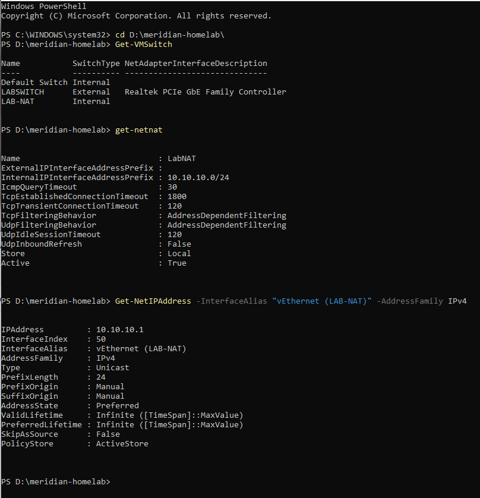

# Phase 1: Hyper-V and Network Setup

**Date:** 2026-10-02
**Time spent:** 2 hours 
**Status:** Done
**Branch:** phase/01-hyperv-network

## Objective
Prepare the Hyper-V host and an isolated lab network, and write down the IP plan and
naming standards before building any servers, so every later machine follows the same rules.

## Prerequisites
- Windows 11 Pro host
- Hardware virtualization enabled in BIOS

## Steps performed
1. Enabled the Hyper-V feature and restarted the host.
2. Created storage folders under `D:\Hyper-V` (VMs, VHDs, ISOs, Templates) and set them as
   the Hyper-V defaults with `Set-VMHost`.
3. Created an internal virtual switch, `LAB-NAT`, and gave the host's adapter the gateway
   address `10.10.10.1`.
4. Created a NAT (`LabNAT`) for `10.10.10.0/24` so VMs can reach the internet through the host.
5. Wrote the [IP plan](../overview/ip-plan.md) and [naming standards](../overview/naming-standards.md),
   and drew the [network diagram](../../diagrams/Meridian.png).

## Verification
Ran these on the host:

- `Get-VMSwitch` showed the `LAB-NAT` internal switch.
- `Get-NetNat` showed `LabNAT` active for `10.10.10.0/24`.
- `Get-NetIPAddress` showed `10.10.10.1` on `vEthernet (LAB-NAT)`.

*Figure 1: The NAT is active and covers the lab subnet.*

## Problems encountered
- `Get-NetAdapter` failed with "No MSFT_NetAdapter objects found" because I left off the
  closing parenthesis in the adapter name (`vEthernet (LAB-NAT`). Correcting it fixed it.

## What I learned
1. An internal switch lets the host and VMs talk to each other, and NAT is what gives
   them internet access through the host.

## Changes I made to the plan
- Used Windows 10 Pro for the clients instead of Windows 11 Enterprise.

## Related files
- [IP plan](../overview/ip-plan.md)
- [Naming standards](../overview/naming-standards.md)
- [Network diagram](../../diagrams/Meridian.png)