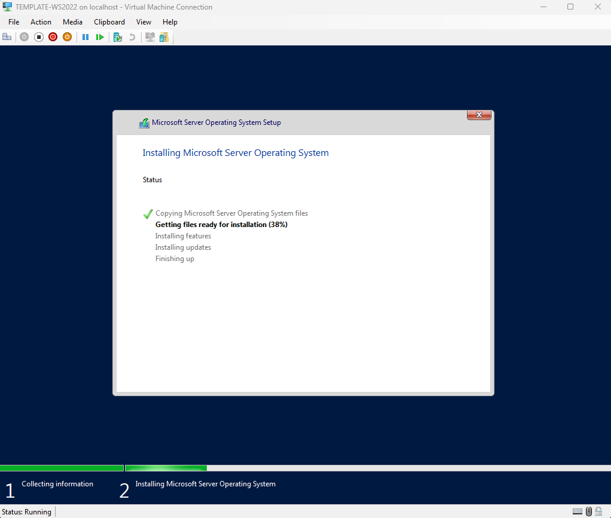
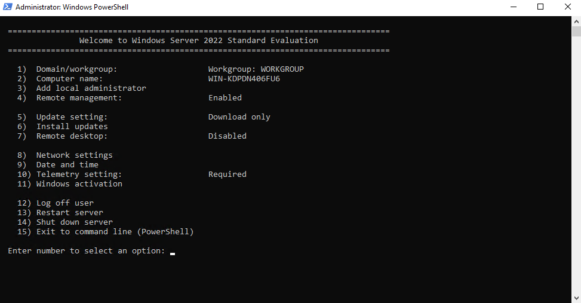
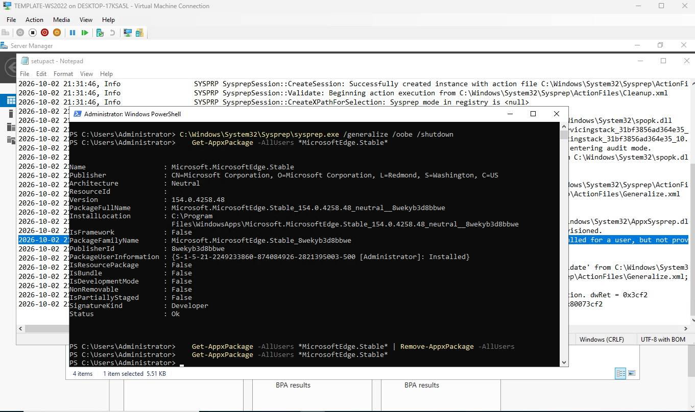

# Phase N: Title

**Date:** 10-2-2026
**Time spent:** 4 hours - mostly waiting on server udpates
**Status:** Done
**Branch:** phase/02-golden-image

## Objective
- Create the golden image for all servers moving forward. Learn aobut sysprep and image creation.

## Prerequisites
- Enable Hyper-V and setup virtual switch.
- Install Windows Server

## Steps performed
1. Modified and ran a script created by Claude AI to create a VM quickly without having to use GUI. See related scripts.
2. Installed Windows Server 2022
   
3. Set temporary IP for server to connect to internet
4. Patched the server
   - sconfig
   - reboot
5. Set basics and ran sysprep to clear the server of all identifying information to make a clean slate for future images
   - Set-TimeZone -Id "Eastern Standard Time"
   - Enabled RDP
   - Turned off telemetry
   - C:\Windows\System32\Sysprep\sysprep.exe /generalize /oobe /shutdown
6. Locked the image file so it can't be damaged.
   - Set-ItemProperty -Path "D:\Hyper-V\Templates\TEMPLATE-WS2022.vhdx" -Name IsReadOnly -Value $true
7. Used Claude AI to create a cloning script to use my template ot quickly spin up VMs witout having to use GUI.
8. Modified the script created with Claude AI to ensure functionality with my environment.

## Verification
1. Confirmed internet ocnnectivity by pinging google dns 8.8.8.8, the by nslookup to confirm dns was resolving ip addresses.
   - ping
   - nsookup
   - test-connection <IP> -Count <number>
2. Checked for updates after patch
   - sconfig: saw no available updates!
    

## Problems encountered
- Sysprep was not able to validate your windows installation
- [Golden image sysprep error](../troubleshooting/phase02/02-golden-image-sysprep-error.md)
-  
   

## What I learned
- I didn't realize how easy it could be to set up multiple VMs at once using a template. Previous I have set up multiple VMs at once by opening them one by one. Now I will never go back to using the old method. 
- sconfig is a super useful cmd to know! it gets you quick access to everything you need to spin up  aserver and get it running, including remote desktop setup, network setup, and naming.

## Related files
- Scripts: , 
- Other docs: `docs/00-overview/ip-plan.md`