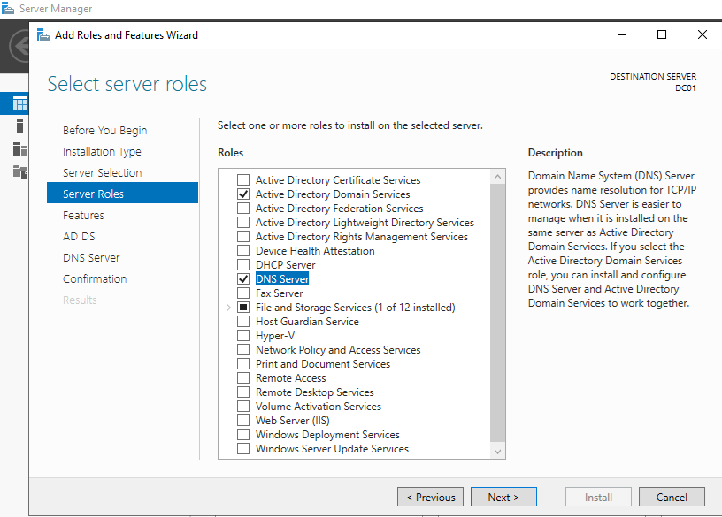
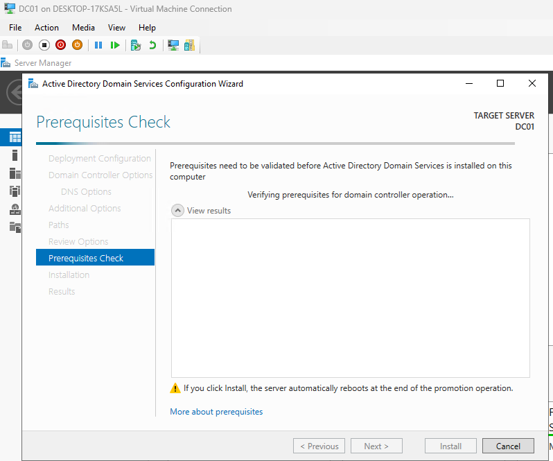
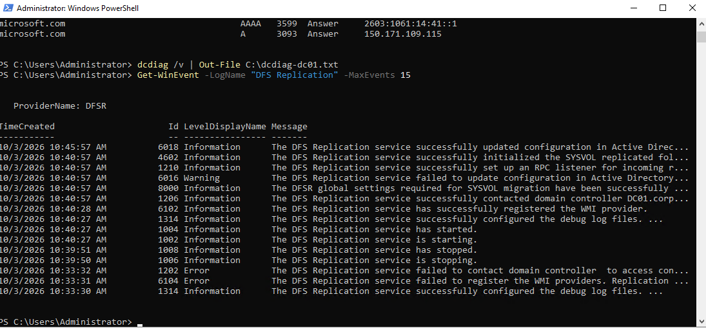

# Phase 3: Creating a Domain Controller and Forest

**Date:** 10-03-2026
**Time spent:** 1 hour
**Status:** Done
**Branch:** phase/03-dc01-forest

## Objective
Build the first domain controller, running Active Directory and DNS, and create the
domain `corp.meridian.lab`.

## Prerequisites
- DC01 VM created from the golden image in [Phase 2](02-golden-image.md)
- Network and IP plan from [Phase 1](01-hyperv-network.md)

## Steps performed
1. Took a Hyper-V checkpoint of DC01 before promotion, in case anything went wrong.
   This is only safe while DC01 is the only domain controller.
2. Named the server `DC01` and gave it the static address `10.10.10.10`, with itself as
   its DNS server. This was dne through `ncpa.cpl`.
3. Installed the Active Directory Domain Services and DNS roles with **Add Roles and
   Features** in Server Manager.

   

   *Figure 1: Installing the AD DS and DNS roles.*

4. Promoted the server with the **Promote this server to a domain controller** wizard in
   Server Manager: added a new forest with the root domain `corp.meridian.lab`, kept DNS
   and the Global Catalog ticked, and set a DSRM (recovery) password. 

   

   *Figure 2: The promotion wizard before installing.*

5. Added DNS forwarders so lab machines can reach the internet:
   `Add-DnsServerForwarder -IPAddress 1.1.1.1, 8.8.8.8`
6. Created a reverse lookup zone so IP addresses resolve back to names:
   `Add-DnsServerPrimaryZone -NetworkId "10.10.10.0/24" -ReplicationScope Domain`
7. Configured DC01 as the domain's time authority (it holds the PDC Emulator role):
   - `w32tm /config /manualpeerlist:"time.windows.com,0x9" /syncfromflags:manual /reliable:yes /update`
   - `Restart-Service w32time`
   - `w32tm /query /status`

## Verification
1. `Get-Service NTDS, DNS, Netlogon, KDC | Select-Object Name, Status` showed all four
   services running.
2. `nslookup` resolved both the hostname and the IP address, confirming forward and
   reverse DNS.
3. `dcdiag /v | Out-File C:\dcdiag-dc01.txt` passed 26 tests and failed 2 (`DFSREvent`
   and `SystemLog`), both explained below.
4. `w32tm /query /status` showed the time source as the Hyper-V Time Synchronization
   provider, not `time.windows.com` (see Problems encountered).

## Problems encountered
`dcdiag` reported two failed tests right after promotion, and the time source was not
what I had configured.

- **DFSREvent failure:** startup timing after promotion. Event IDs 4602 and 6018 later in the
  log showed DFS Replication recovering on its own.
  [Troubleshooting entry](../troubleshooting/phase03/03-DFSR-failure.md)

  

  *Figure 3: DFS Replication initialized successfully after the earlier errors.*

- **SystemLog failure:** the test fails on any warning in the last 24 hours, and a new DC
  always has some. [Troubleshooting entry](../troubleshooting/phase03/03-SystemLog-failure.md)
- **Time source:** `time.windows.com` did not resolve on first try, and DC01 was syncing
  from the Hyper-V host instead. [Troubleshooting entry](../troubleshooting/phase03/03-Time-failure.md)

## What I learned
1. Errors are expected right after promoting a DC. `dcdiag` flagged startup timing issues,
   and the event log showed them clearing without any change from me.
2. Forward and reverse DNS are separate zones. Promotion created the forward zone for the
   domain, but I had to create the reverse zone myself.
3. A VM can take its time from the Hyper-V host through integration services, which can
   take priority over the NTP server I configured.

## Related files
- [IP plan](../overview/ip-plan.md)
- [DFSR troubleshooting](../troubleshooting/phase03/03-DFSR-failure.md)
- [SystemLog troubleshooting](../troubleshooting/phase03/03-SystemLog-failure.md)
- [Time troubleshooting](../troubleshooting/phase03/03-Time-failure.md)