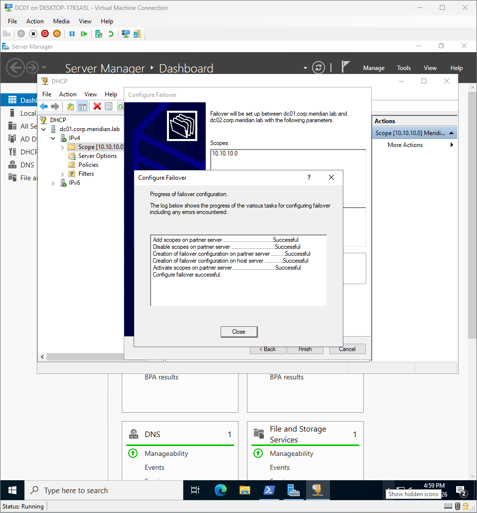
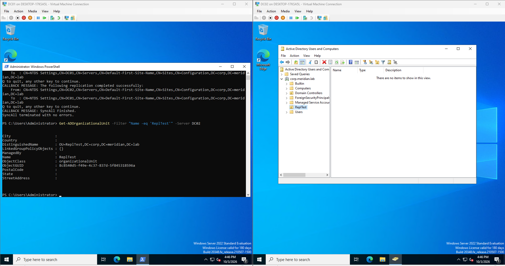
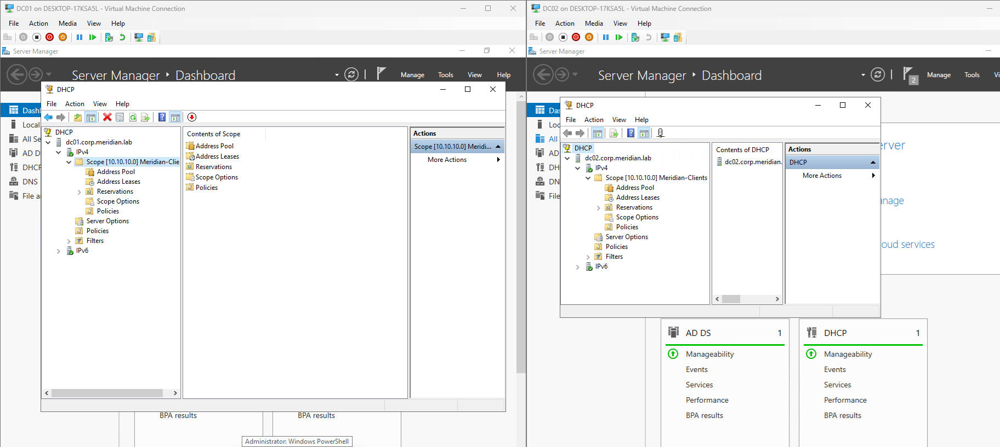
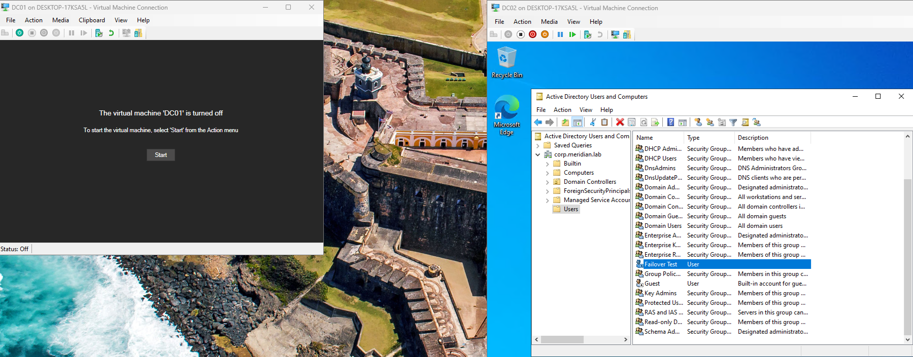

# Phase 4: DC02, DHCP, and Failover

**Date:** 2026-10-03
**Time spent:** 2 hours
**Status:** Done
**Branch:** phase/04-dc02-dhcp

## Objective
Remove the single point of failure. DC02 gives the domain a second domain controller
for logons and DNS, and DHCP failover lets either server hand out addresses if the
other goes down.

## Prerequisites
- DC01 promoted and healthy ([Phase 3](03-dc01-forest.md))
- DC02, FS01, and PS01 created from the golden image ([Phase 2](02-golden-image.md))

## Steps performed
1. Set up DHCP on DC01 in the GUI:
   - Added the DHCP Server role with **Add Roles and Features** in Server Manager.
   - Ran **Complete DHCP configuration**, which created the DHCP Administrators and
     DHCP Users groups and authorized DC01 in Active Directory.
   - In the DHCP console, created the `Meridian-Clients` scope with the New Scope wizard:
     `10.10.10.100` to `10.10.10.200`, mask `255.255.255.0`, 8-day lease.
   - Set the scope options in the wizard: router `10.10.10.1`, DNS domain
     `corp.meridian.lab`, and the DNS servers. [Say which DNS servers you entered.]
   - Activated the scope.
2. Built DC02: gave it `10.10.10.11`, pointed its DNS at DC01, confirmed it could resolve
   `corp.meridian.lab`, installed AD DS and DNS with **Add Roles and Features**, and
   promoted it as an additional domain controller in the existing domain with the
   Server Manager promotion wizard.
3. Set the DNS client order on each DC: the other DC first, itself (`127.0.0.1`) second.
4. Added DNS forwarders on DC02, since forwarders are per-server and do not replicate:
   `Add-DnsServerForwarder -IPAddress 1.1.1.1, 8.8.8.8`
5. Set up DHCP failover:
   - On DC02, installed the DHCP Server role and ran **Complete DHCP configuration** to
     authorize it.
   - On DC01, right-clicked the `Meridian-Clients` scope, chose **Configure Failover**,
     and used the wizard with DC02 as the partner in load-balance mode, 50/50, with
     message authentication. The scope and its options were copied to DC02.

   

   *Figure 1: The failover relationship between DC01 and DC02.*

6. Renamed the default AD site to `HQ-Lab` and added the
   `10.10.10.0/24` subnet in Active Directory Sites and Services.

## Verification
1. Confirmed the DHCP configuration on DC01:
   - `Get-DhcpServerInDC` listed the authorized server
   - `Get-DhcpServerv4Scope` showed `Meridian-Clients` as Active
   - `Get-DhcpServerv4OptionValue -ScopeId 10.10.10.0` listed the scope options
2. Proved replication with a canary test: created an AD object on DC01 and confirmed it
   appeared on DC02.

   

   *Figure 2: The test object exists on both domain controllers.*

3. Confirmed the failover relationship and that DC02 now holds the scope.

   

   *Figure 3: Failover state and the scope on DC02.*

4. Ran a failover test by shutting down DC01:
   - `nltest /dsgetdc:corp.meridian.lab` returned DC02
   - Created and deleted a user on DC02, showing Active Directory still accepted writes

   

   *Figure 4: The domain kept working with DC01 offline.*

## Problems encountered
- **The DNS servers option was missing from the DHCP scope.** DC02 did not exist yet when
  I configured the scope, so the second DNS server could not be validated, and the option
  ended up unset. I did not notice until Phase 8, when clients received an address and
  gateway but could not find the domain. `Get-DhcpServerv4OptionValue` showed no DNS
  server option. Issue was resolved by setting the DNS servers on the scope again and running 
  `ipconfig /renew` on the client.
  - Prevention: build DC02 before configuring the scope options, and check the options
    list right after creating the scope.

## What I learned
1. Configuration can look finished while one setting is missing, so I need to check the
   result of each setting and not only that the service is running.
2. DHCP failover copies the scope and its options to the partner, and the wizard is run
   from the server that already has the scope.
3. Hyper-V checkpoints are safe on DC01 only while it is the only domain controller.

## Related files
- [IP plan](../overview/ip-plan.md)