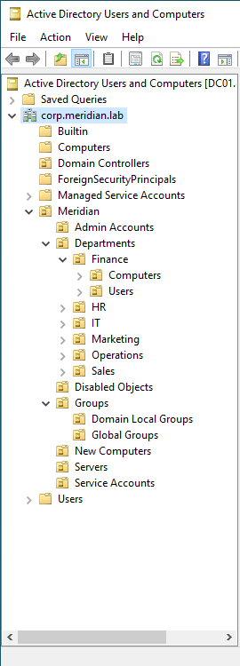

# Phase 5: OU, Users, and Groups

**Date:** 10-3-2026
**Time spent:** 2 hours
**Status:** Done
**Branch:** 05-ou-users-groups

## Objective
Design and build a clean, scalable OU struture with mulitple departments and users.

## Steps performed
1. Whiteboarded an OU struture, then used Claude AI to create a script to automate OU and group creation.
   - This was done mainly to save time, as I already have experience creating OU and security groups.
   
2. Redirect new computers into the new computers OU
3. Create Users
   - Created a CSV with random users, departments, and titles
   - Used a script from work to create users quickly
4. Start making the groups functional
   - Delegate control for the departments OU to group for helpdesk to enable poassword reset permissions
5. Create my own admin account
6. Enabled AD recycle bin
   - Prevents things from being permanently delted unless intended

## What I learned
I was completely unaware you could change the default location of new computers! This is super nice, and I can see it being useful in my current workflow, so I will be bringing this up to our administration team.

## Related files
- [Script](../../scripts/06-new-ou-structure.ps1)
- [Script](../../scripts/07-new-ad-users.ps1)
- [Decisions](../decisions/phase05.md)