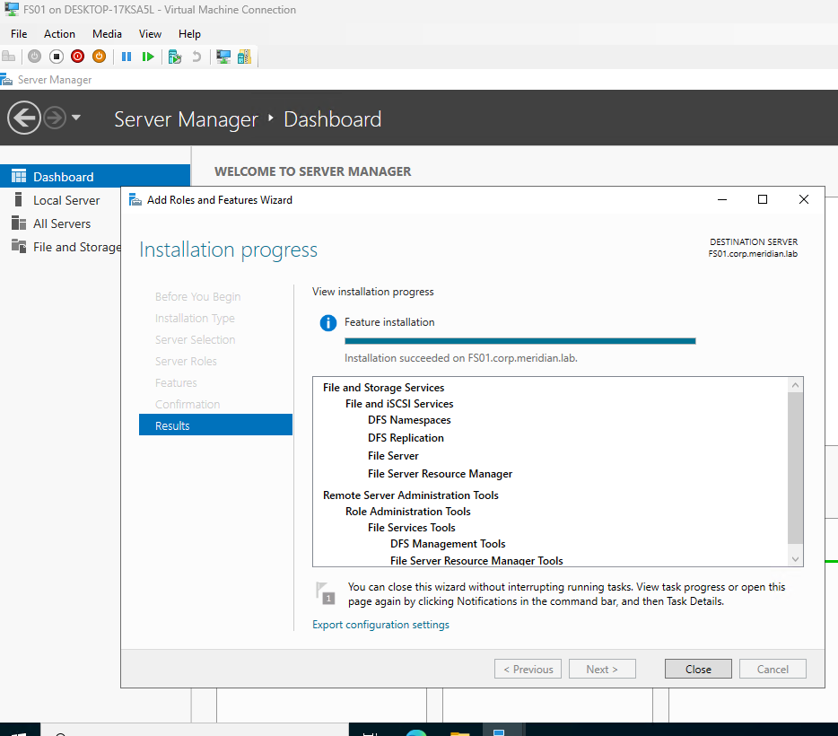
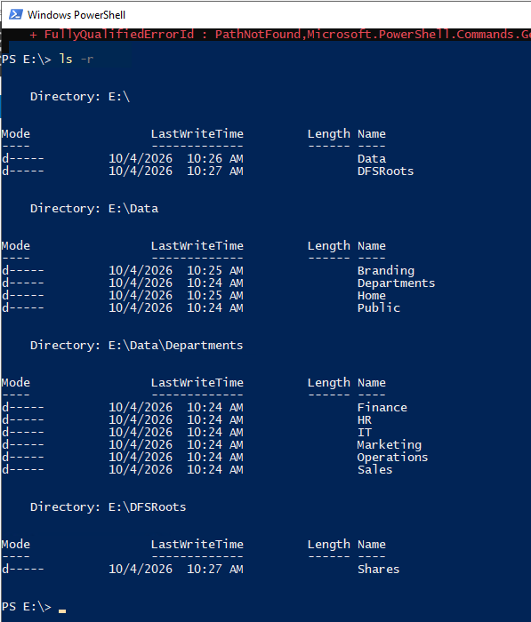
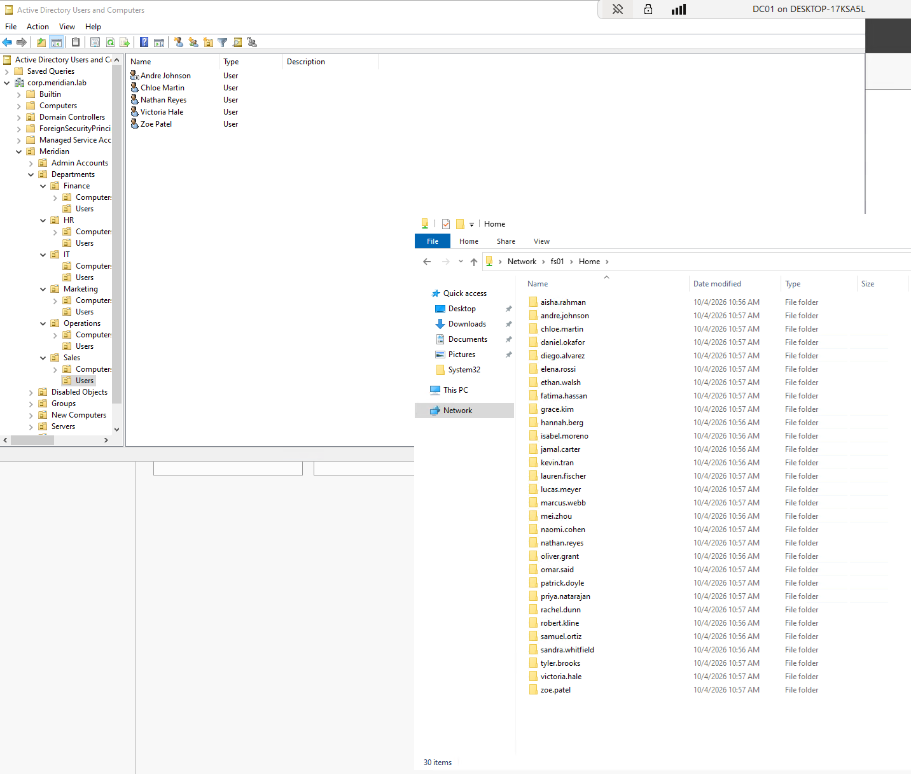
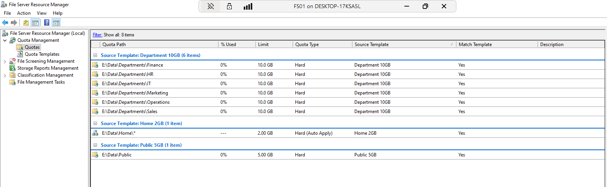
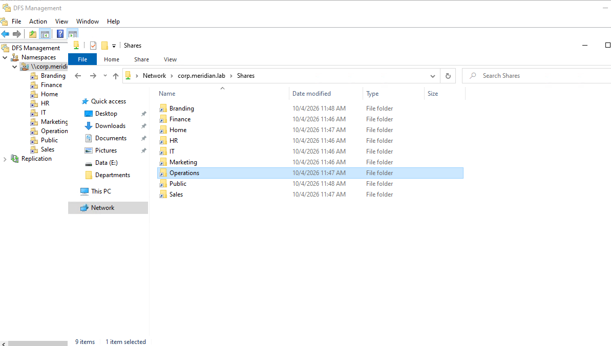
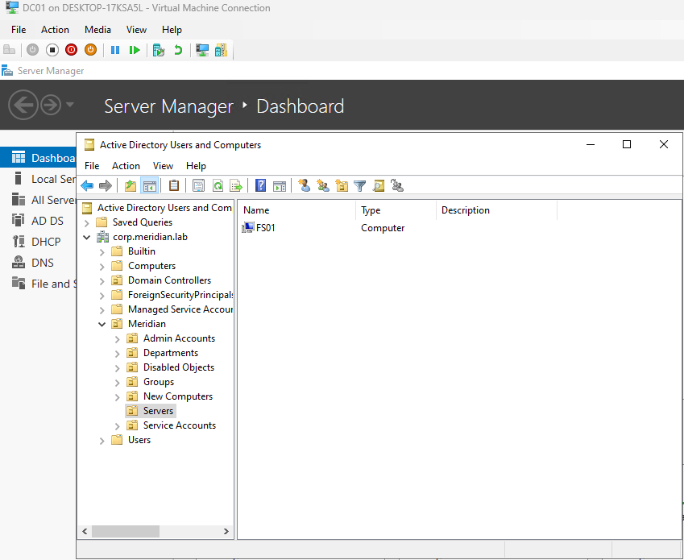
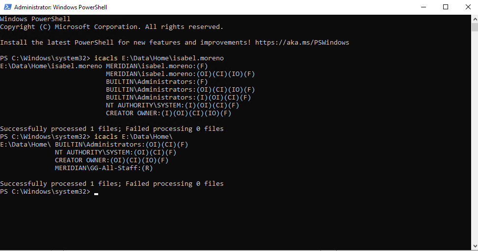
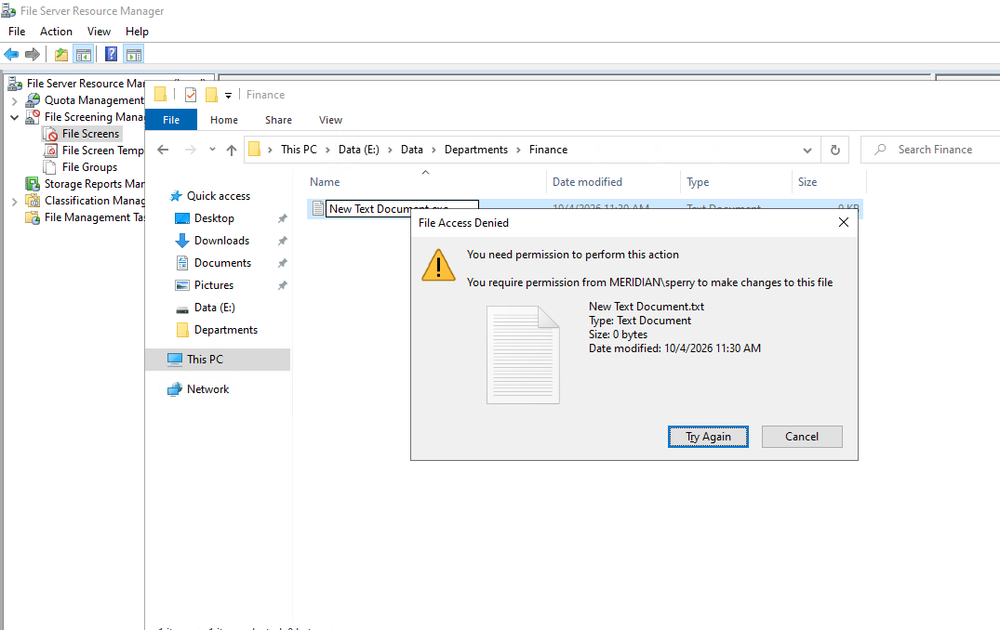
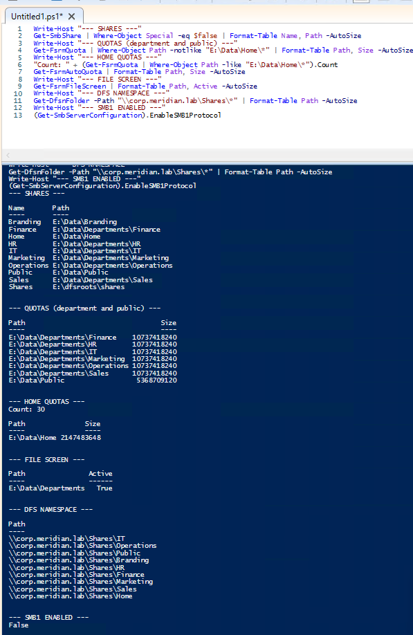
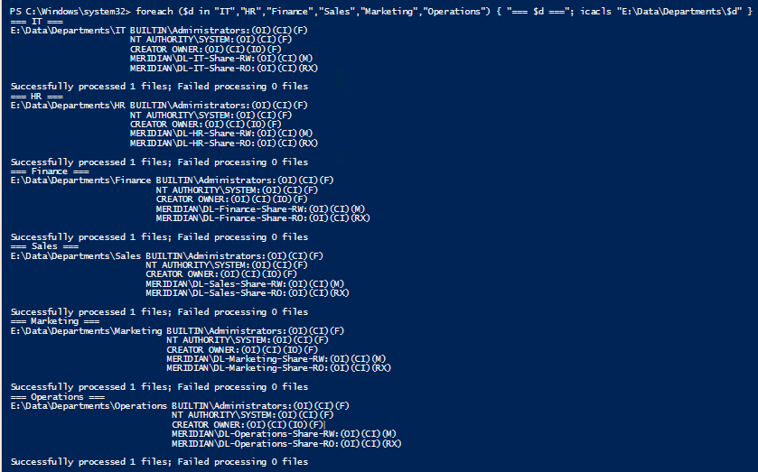

# Phase 6: File Server, Shares, Quotas, and DFS

**Date:** 2026-10-04
**Time spent:** 5 hours
**Status:** Done
**Branch:** 06-file-server

## Objective
Build a file server that provides:
- A private share for each department
- A public read-only share
- A personal home folder for each user
- A place for Group Policy files, such as wallpaper images

## Prerequisites
- OUs, users, and groups from [Phase 5](05-ou-users-groups.md)
- FS01 created from the golden image ([Phase 2](02-golden-image.md))

## Steps performed
1. Planned the shares: whiteboarded the share folders, the groups that need access, the
   folder structure, and separate read-only groups so access can be granted as needed.
   The result is the [permissions matrix](evidence/permissions-matrix.md).
2. Set up the server: gave FS01 its address and name, joined it to the domain, and moved
   it to the `Servers` OU.
3. Prepared the data disk in Server Manager and Disk Management: brought the 100 GB disk
   online, initialized it, and formatted it as `E:`.
4. Installed the File Server, File Server Resource Manager, DFS Namespaces, and DFS
   Replication features with **Add Roles and Features**.

   

   *Figure 1: The file server features installed.*

5. Created the folder structure in File Explorer under `E:\Data`.

   

   *Figure 2: The folder tree, listed recursively.*

6. Set NTFS permissions on each folder in the Security tab. Access goes only to the `DL-`
   groups: Modify for the department's read-write group and Read for its read-only group.
   Inheritance was turned off and the default Users entries removed.
7. Shared the folders. All shares use broad share permissions, with NTFS doing the real
   control, and access-based enumeration turned on for the department shares.
8. Set up home folders: set each user's **Home folder** (`H:` to `\\FS01\Home\%username%`)
   in Active Directory Users and Computers, which created their folders.

   

   *Figure 3: User folders created automatically.*

9. Set quotas and a file screen with File Server Resource Manager:
   - Created quota templates (10 GB departments, 5 GB Public, 2 GB home folders) and applied
     them, with an auto quota on `Home`.
   - Created an active file screen on the department folders that blocks executable, audio,
     and video files.

   

   *Figure 4: Quotas applied to the shares.*

10. Turned on shadow copies for the data drive, so users can restore deleted or overwritten
    files from Previous Versions.
11. Created a DFS namespace, `\\corp.meridian.lab\Shares`, with a link for each share. It
    hides the server name from users, and lets Group Policy point at a clean path so the file
    server can be replaced or renamed without changing anything else.

    

    *Figure 5: The namespace and its folder links in DFS Management.*

## Verification
1. FS01 appears in the `Servers` OU on DC01.

   

2. Home folder permissions are set correctly. They are trickier than the others, because
   each user has Full control of their own folder and nobody else has access.

   

3. The file screen works: saving an `.exe` into a department folder was blocked.

   

4. PowerShell check of the shares, quotas, file screen, and DFS links on FS01.

   

5. `icacls` output for the department folders, showing only the `DL-` groups plus
   Administrators and SYSTEM.

   

The user tests from a client (Finance user can open Finance, HR user is denied) were done
in [Phase 8](08-clients.md).

## Problems encountered
1. I could not create the home folders at first, because DC01 could not reach the folder
   path. The `Home` folder was not shared yet, so there was no network path. I shared it
   and the problem went away.
2. The File Server Resource Manager console threw "An unexpected error has occurred" on
   the Custom file screen button, the quota notification Add button, and Configure Options.
   The event log showed an exception in the console's report page, and the service was
   running. A second reboot cleared it.

## What I learned
1. I was unaware of the DFS namespace process. 

## Related files
- [Permissions matrix](evidence/permissions-matrix.md)
- [IP plan](../overview/ip-plan.md)