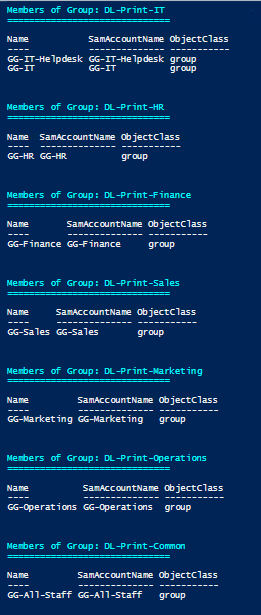
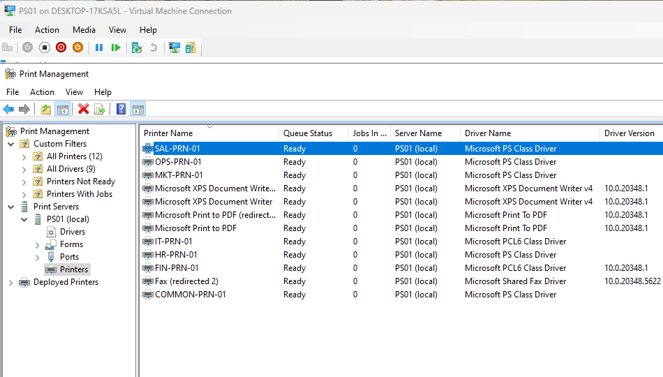

# Phase 07: Print Server

**Date:** 10-4-2026
**Time spent:** 3 hours
**Status:** Done
**Branch:** 07-print-server

## Objective
1. Create a print server that hosts 7 printer queues. One for each department and one common printer. Each department will be limited to their printer.

## Steps performed
1. Planning
    - Printer per department, groups, ip
    - [Plan](../decisions/phase07.md)
2. Create Print Groups on DC and set members
    - 
3. Prepare Print server
    - Network
    - Name
    - AD Join
    - Install Features
4. Add printers
    - 
5. Harden DCs
    - Stop Print Spooler
    - Stop spooler from restarting on startup
6. Created a backup of print queues

## Verification
1. Confirmed print queue backup works by deleteing a single printer and importing from backup file

## What I Learned
1. Print Spooler is VERY poorly secured, and needs ot be hardened on DCs.

## Related Files
[Runbook](../runbooks/phase07/print-spool-clear.md)