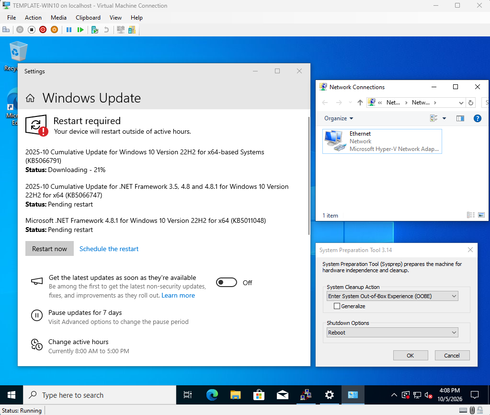
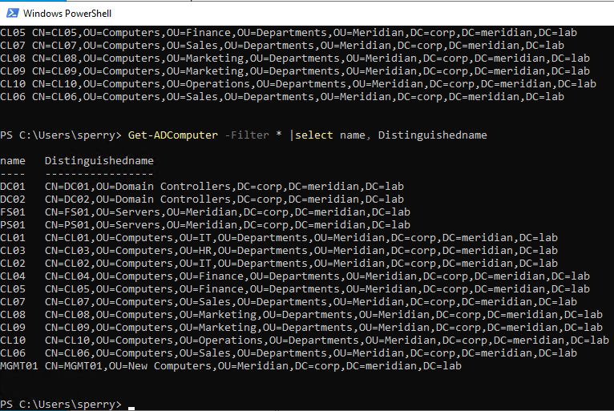
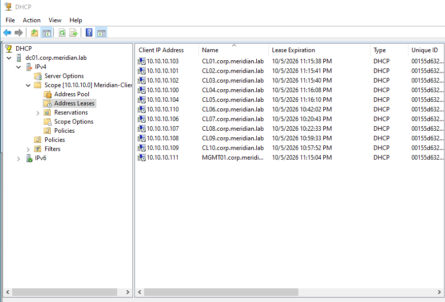
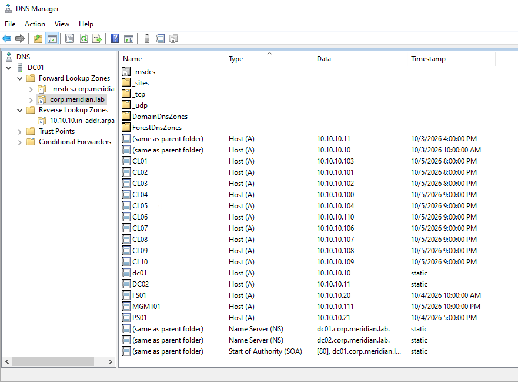
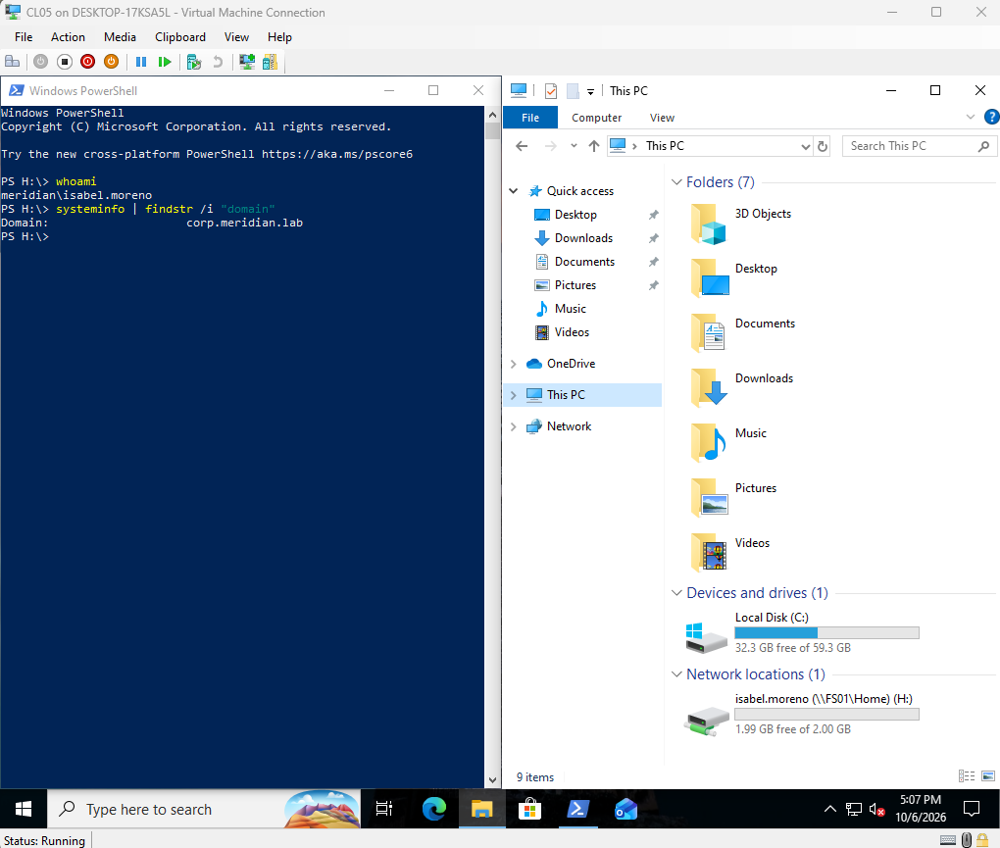
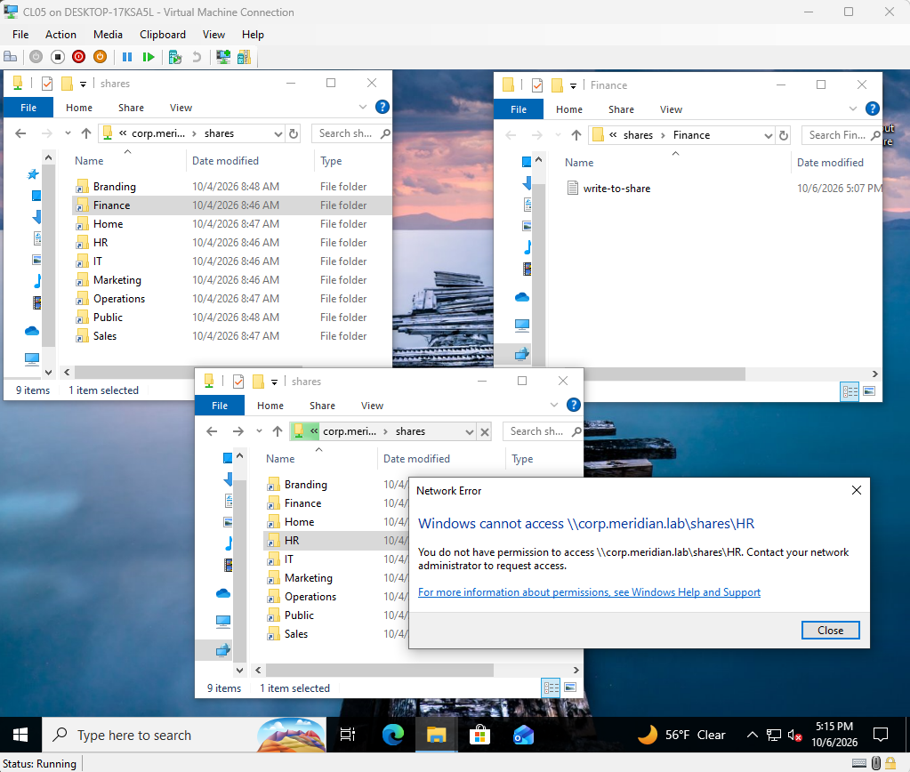
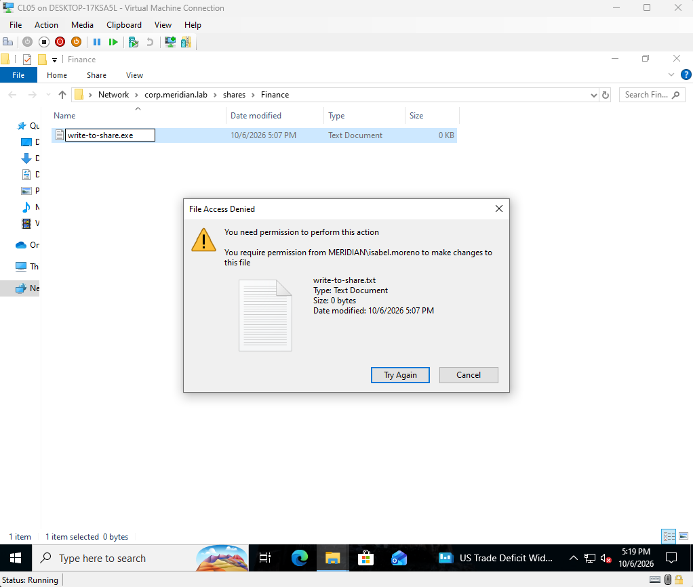
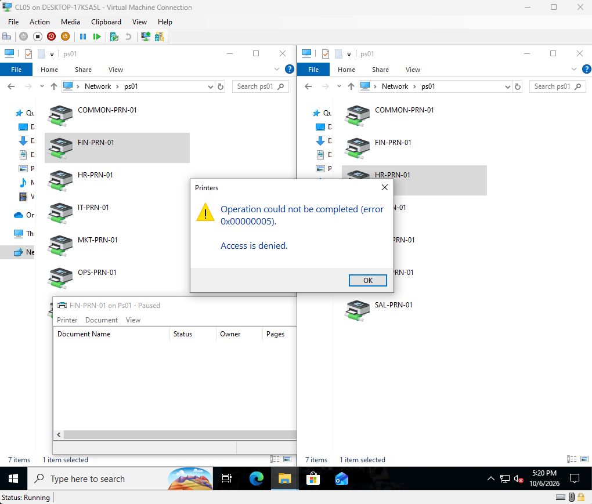
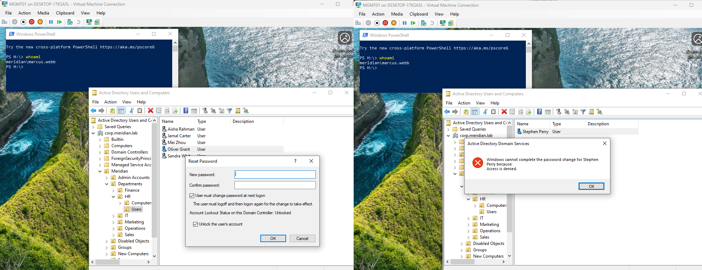

# Phase 8: Clients

**Date:** 2026-10-05
**Time spent:** 5 hours
**Status:** Done
**Branch:** phase/08-clients

## Objective
Build ten Windows 10 Pro client PCs joined to the domain and placed in department OUs, plus
an admin workstation (`MGMT01`) with remote administration tools.

## Prerequisites
- Domain, DHCP, and DNS working on both domain controllers ([Phase 4](04-dc02-dhcp.md))
- Department OUs and users ([Phase 5](05-ou-users-groups.md))
- A Windows 10 Pro ISO in `D:\Hyper-V\ISOs`

## Steps performed
1. Created the template VM with a PowerShell script (drafted with Claude, edited by me for
   my ISO name and memory size). It builds a Generation 2 VM with Secure Boot and a virtual
   TPM. See [related files](#related-files).
2. Installed Windows 10 Pro.
3. Built the golden image in Audit mode:
   - Pressed Ctrl+Shift+F3 at the first setup screen to enter Audit mode
   - Gave the VM a temporary network setting so it could reach the internet
   - Installed all Windows updates
   - Installed the software I wanted on every PC: Notepad++ and 7-Zip
   - Removed pre-installed applications to debloat the image
   - Cleared the browser cache, deleted downloaded installers, and set the network back
     to automatic (DHCP)
   - Ran Sysprep with **Enter System Out-of-Box Experience (OOBE)**, **Generalize**, and
     **Shutdown**

   

   *Figure 1: Updates running and OOBE.*

4. Made the template disk read-only, and used a second script to create the clients as
   differencing-disk VMs from the template (`CL01` to `CL10` and `MGMT01`).
5. Set up each client on first boot (local account and PC name), then joined it to the
   domain from System Properties and moved it to its department's `Computers` OU in Active
   Directory Users and Computers.
6. Set up the management machine, `MGMT01`:
   - Gave it a static IP outside the DHCP scope (`10.10.10.30`)
   - Installed the RSAT tools (Active Directory, Group Policy, DNS, DHCP, File Services,
     Server Manager, and Print Management)
   - From now on I administer the lab from this machine, which limits the time I spend
     logged in to the domain controllers.

## Verification
1. All clients appear in Active Directory in their department OUs.

   

   *Figure 2: Computer accounts in the department OUs.*

2. The clients received DHCP leases.

   

   *Figure 3: DHCP leases for the clients.*

3. The clients registered in DNS.

   

   *Figure 4: DNS records for the clients.*

4. A domain user signed in on a domain-joined PC, with access to their home folder and
   department shares.

   

   *Figure 5: The signed-in user and their mapped home folder.*

5. A Finance user browsed `\\corp.meridian.lab\shares`, opened Finance and created a file,
   and was denied when opening HR.

   

   *Figure 6: Access to Finance succeeds, and access to HR returns "You do not have
   permission to access."*

6. The file screen blocked saving an `.exe`.

   

   *Figure 7: The file screen refuses the file.*

7. Printer permissions: the user can use only their department's printer.

   

   *Figure 8: The Finance printer connects, and the other department's printer is denied.*

8. A helpdesk user could reset a regular user's password through delegated control, but not
   an admin account's.

   

   *Figure 9: The password reset succeeds for a department user and is denied for an admin.*

## Problems encountered
- CL06 failed to boot (suspected corruption in its child disk), and was rebuilt from the
  template. The nine others from the same template worked, which isolated the fault.
- The DHCP scope was missing its DNS servers option, so clients had an address but could
  not find the domain. See [Phase 4](04-dc02-dhcp.md).

## Related files
- Scripts:
  - [Windows 10 template VM](../../scripts/08-win10-template.ps1)
  - [Client creation](../../scripts/08-new-clients.ps1)