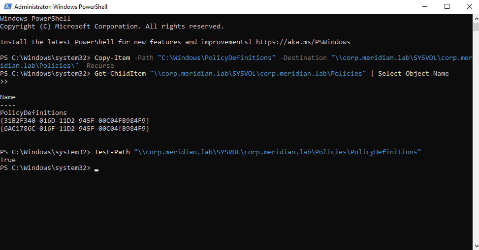
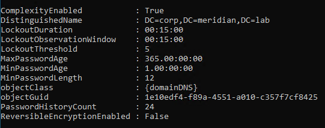
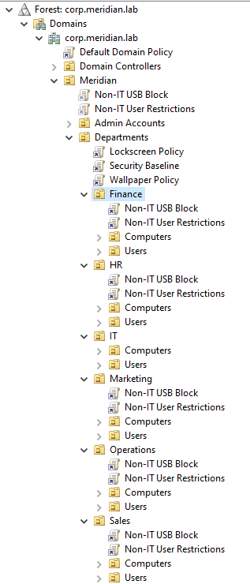
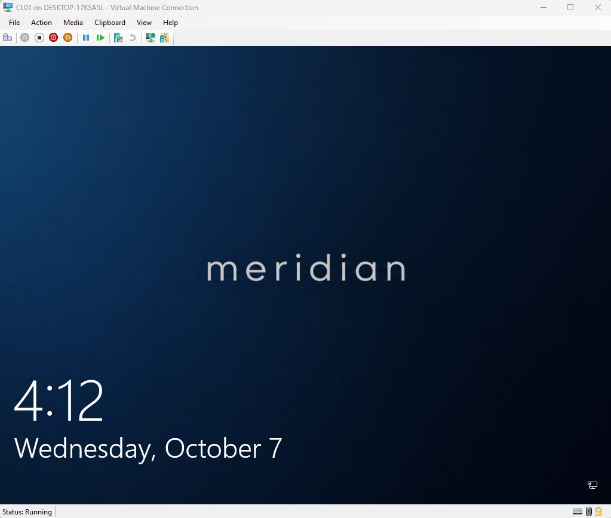
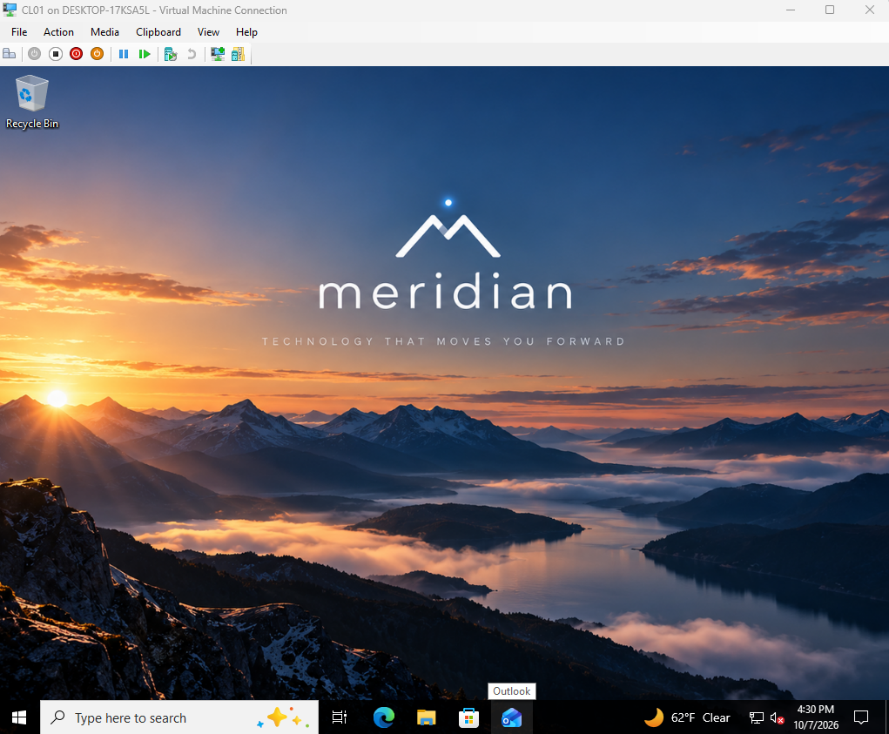
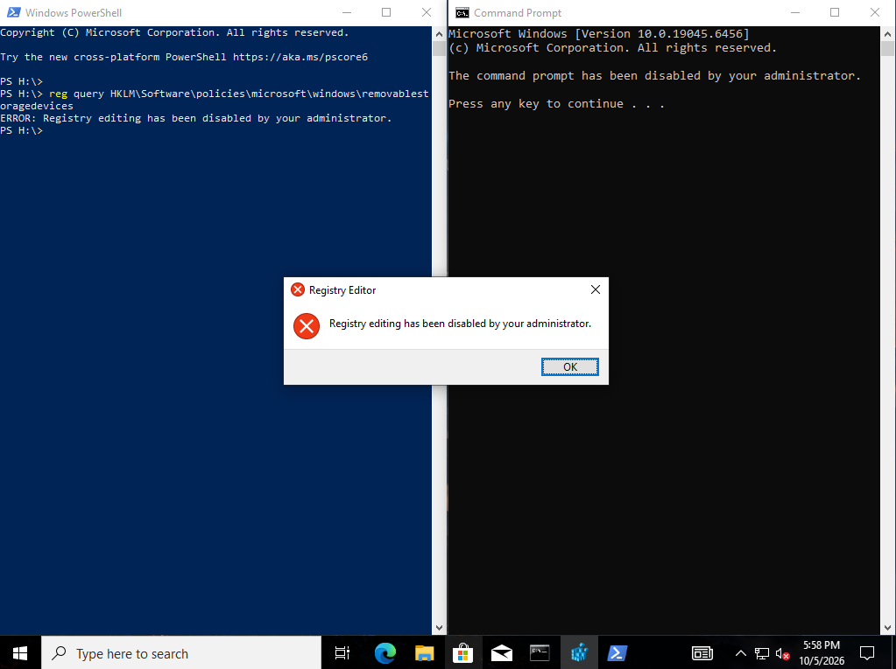
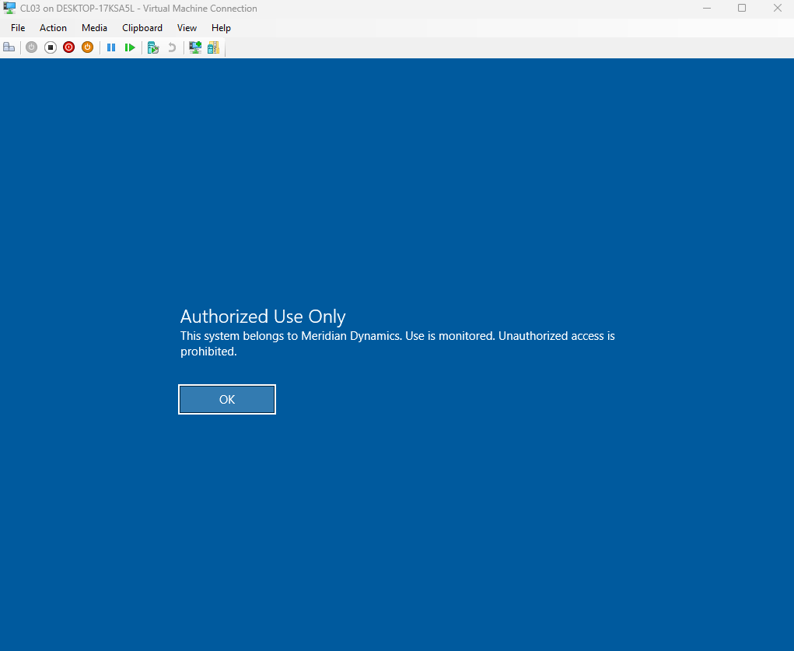
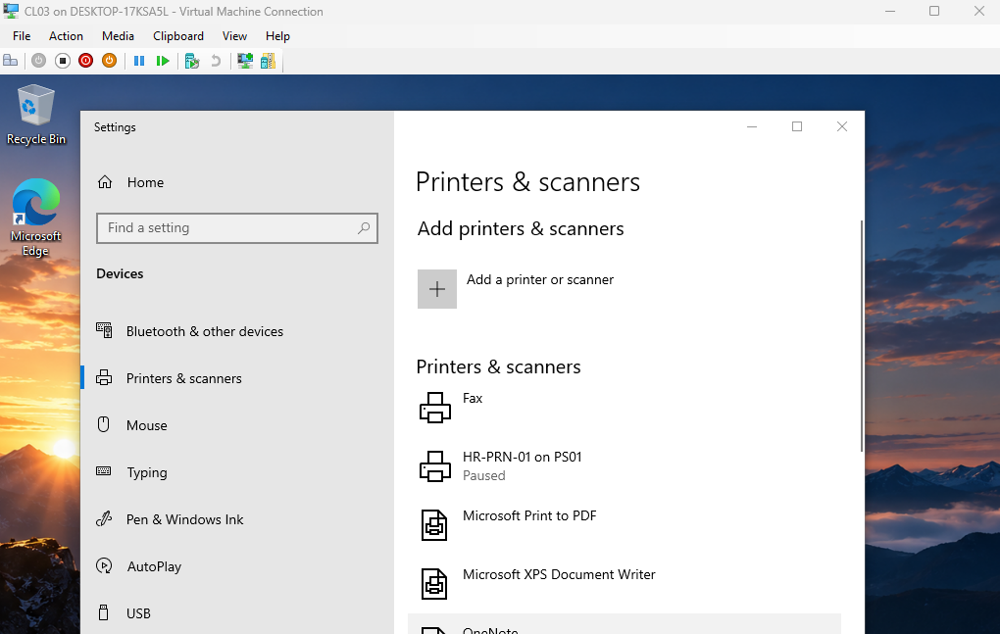

# Phase 09: Group Policy

**Date:** 10-7-2026
**Time spent:** 3 hours
**Status:** Done
**Branch:** 09-group-policy

## Objective
1. Create and link GPO to OU for control resources and settings.

## Steps performed
1. Created central store for policy definitions
    - 

        *CMDs for creation and verification of central store folder creation*
2. Set password policy for domain
    - 
        
        *Confirmation of password policy setting*
3. Created a lockscreen GPO
    - GPO creates a local file in windows default lockscreen folder that is a copy of the lockscreen image in "\\FS01\Branding"
        - This enables the image to be updated at any time
    - GPO creates registry keys bypassing lockscreen GPO limitations for Windows 10 Pro
4. Created a lockscreen GPO
5. Created a security GPO
    - Set logon message "This system belongs to Meridian Dynamics. Use is monitored. Unauthorized access is prohibited."
6. Created a GPO that block USB access for all Non-IT users
7. Created a GPO that blocks:
    - All control panels items except for mouse settings
    - Settings
    - Command Prompt
    - Registry Editor
    - 
8. Created a drive and prtiner GPO for each department
    - Mapped public drive to all users as P:
    - Mapped department drives as S:
    - Mapped department printers and set as default
9. Created a GPO that gives helpdesk local admin rights to PCs in the departments OU
    - Creates a local group called "Administrator (built-in)"
        - The member of this group is the helpdesk security group
10. Test Scenario
    - Blocked inheritance on Finance OU and watched the lockscreen and wallpaper gpo fail to apply.
    - Enforeced these policies and watched them re-apply, bypassing the inheritance block
11. Performed a backup of all GPO

## Verification
1. 

    *Lockscreen is working*
2. 

    *Wallpaper GPO is working*
3. 

    *CMD, USB, Reg Edit restricted*
4. 

    *Logon mesage appears before user logon*
5. 

    *Printer successfully mapped after GPO update*

## Problems encountered
1. Printer was not mapping

## Changes Made to Plan
1. Decided to split lockscreen and wallpaper into separate GPO
2. Some of the GPO names were changed from the plan

## What I Learned
1. A Group Policy Preference can add a domain security group to the local Administrators
   group on every PC in an OU. Using it, `GG-IT-Helpdesk` has admin rights on all department
   computers with no shared local password. Access follows group membership: adding or
   removing someone from the group is the only change needed.

## Related Files
1. [Printer-map-error](../troubleshooting/phase09/09-printer-map-failure.md)
2. [Break-testing-1](../troubleshooting/phase09/09-gpo-computer-in-wrong-ou.md)
3. [Break-testing-2](../troubleshooting/phase09/09-gpo-block-inheritance-enforced.md)
4. [GPO-backup](../../gpo-backups/GPOBackup/)