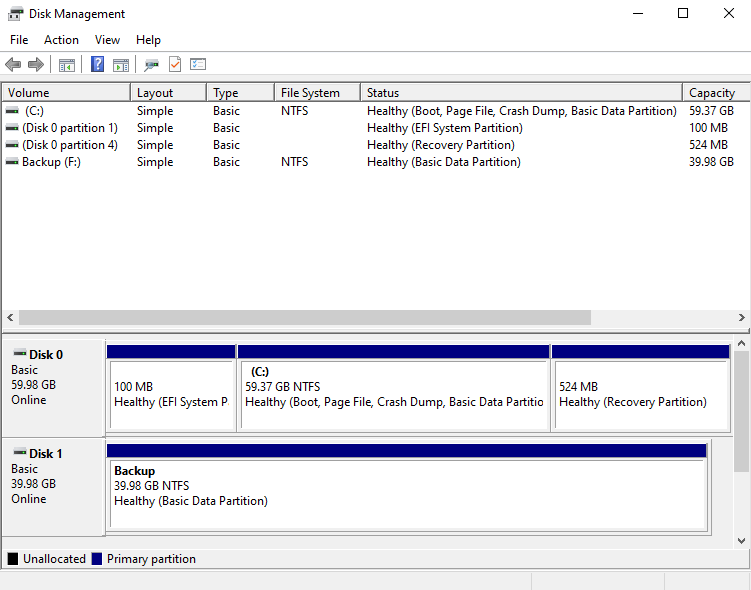
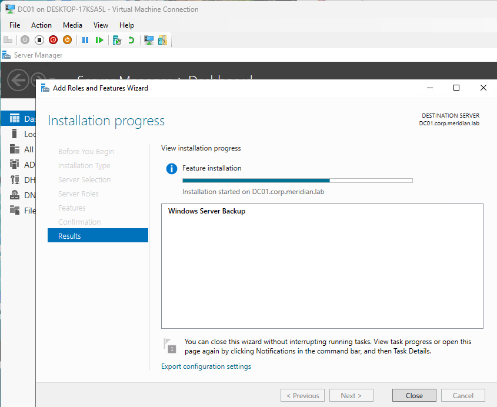
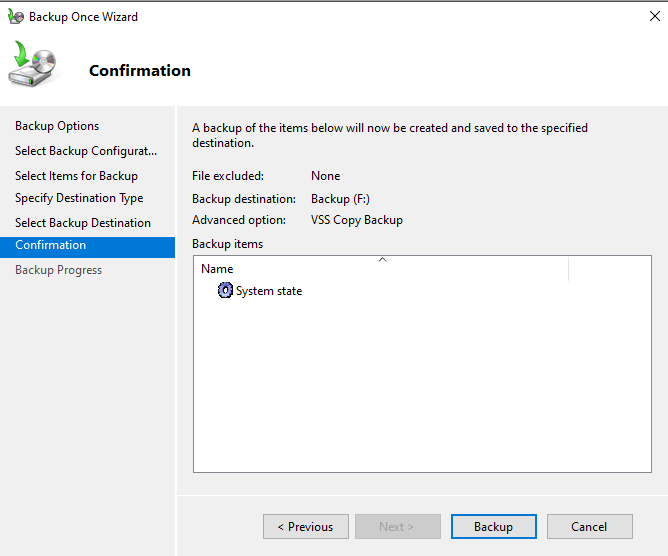
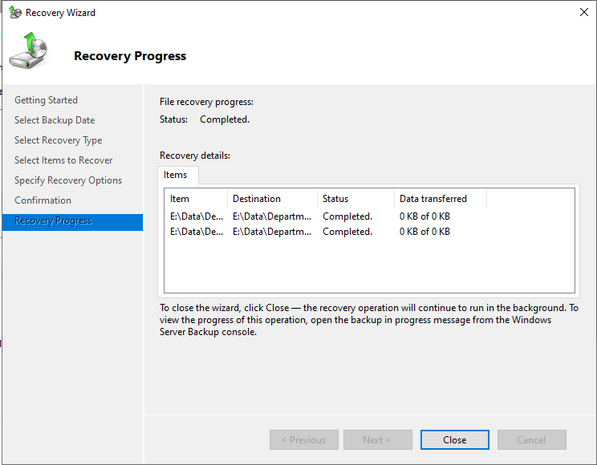
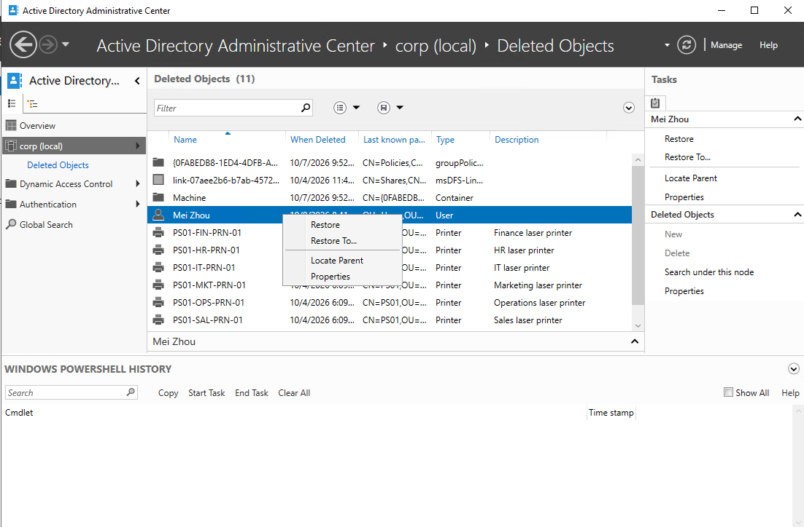
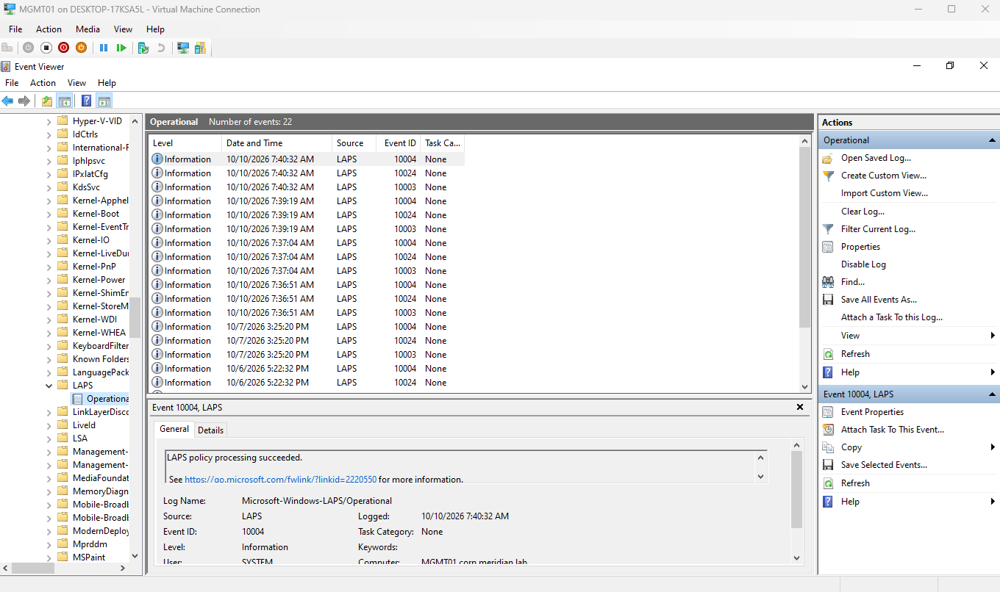
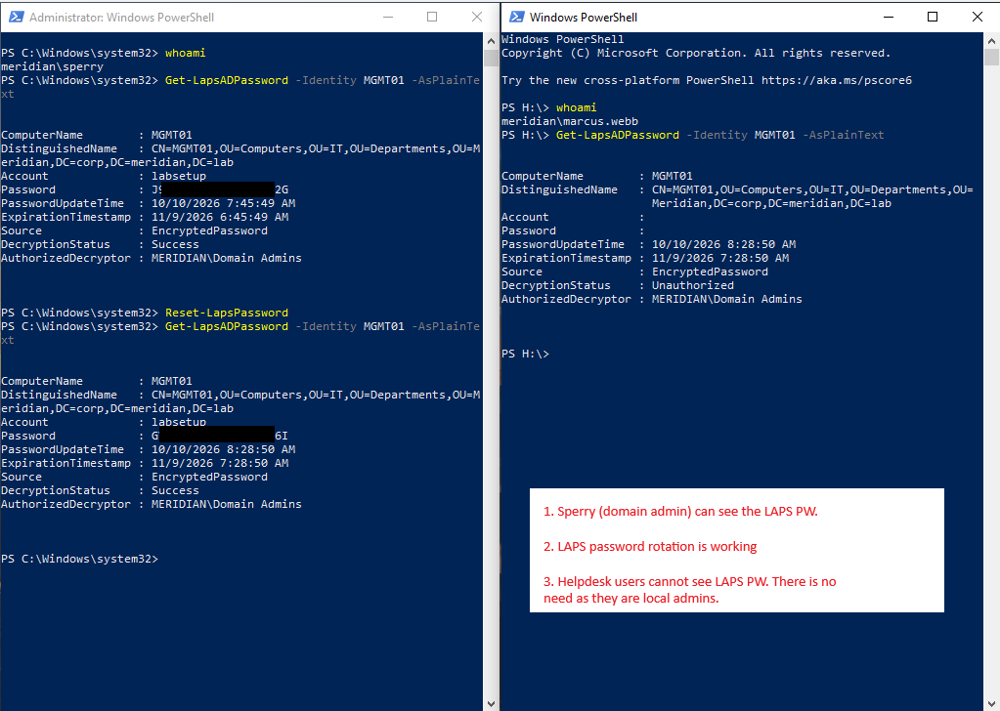
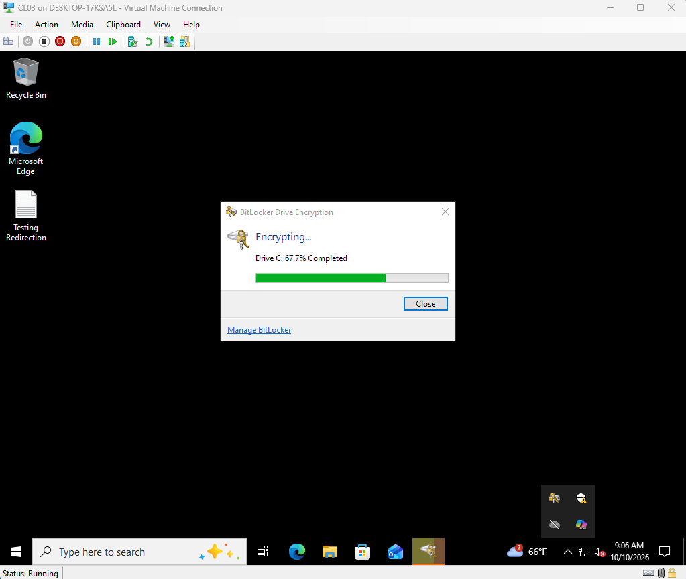
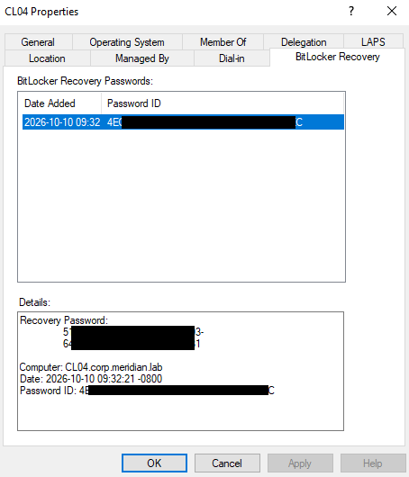

# Phase 10: Leveling Up

**Date:** 10-4-2026
**Time spent:** 5 hours
**Status:** Done
**Branch:** Phase/10-level-up

## Objective
1. Perform a backup and restore test
2. Implement Windows LAPS
3. BitLocker with keys escrowed in AD

## Backup and Restore Test
1. Created a virtual drive for DC01-backup.
2. Initialized the drive and created a volume.

   

3. Installed Windows Server Backup.

   

4. Backed up DC01, including system state.

   

5. Repeated the steps for FS01, after creating a test folder and file.
6. Deleted the test files.
7. Recovered the test files from the backup.

   

8. Practiced the Active Directory Recycle Bin by deleting and recovering a user.

   

## LAPS
1. Checked that the Central Store has the LAPS template: `LAPS.admx` and `en-US\LAPS.adml`
   in `\\corp.meridian.lab\SYSVOL\corp.meridian.lab\Policies\PolicyDefinitions`.
2. Prepared Active Directory:
   - Added the LAPS attributes to the schema: `Update-LapsADSchema`
   - Let each PC in the Departments OU write its own password:
     `Set-LapsADComputerSelfPermission -Identity "OU=Departments,OU=Meridian,DC=corp,DC=meridian,DC=lab"`
   - Gave the helpdesk group the AD right to read password records **This does not give them the ability to decrypt and read passwords**:
     `Set-LapsADReadPasswordPermission -Identity "OU=Departments,OU=Meridian,DC=corp,DC=meridian,DC=lab" -AllowedPrincipals "MERIDIAN\GG-IT-Helpdesk"`
3. Created the GPO that turns on LAPS for clients, under **Computer Configuration, Policies,
   Administrative Templates, System, LAPS**:
   - **Configure password backup directory:** enabled, set to Active Directory
   - **Name of administrator account to manage:** enabled, set to `labsetup`
   - **Password Settings:** enabled, with uppercase, lowercase, numbers, and special
     characters, a length of 20, and an age of 30 days
4. Tested on the first client, MGMT01:
   - Ran `gpupdate /force` and `Invoke-LapsPolicyProcessing` to load the policy and make LAPS
     generate a password. `Invoke-LapsPolicyProcessing` has to be run as administrator.
   - Checked **Applications and Services Logs, Microsoft, Windows, LAPS, Operational**.

     

     *Figure 1: LAPS policy processing succeeded.*

   - LAPS worked after some troubleshooting (see Problems encountered).

     

     *Figure 2: The LAPS password is readable by a domain admin but not by the IT helpdesk,
     and rotation works.*

## BitLocker
1. Confirmed the clients have a TPM. The virtual TPM was enabled on the test client.
2. Created a Hyper-V checkpoint of CL03 before encrypting it.
3. Created a GPO, `All-Bitlocker`, in Group Policy Management and linked it to the
   `Departments` OU. Under **Computer Configuration, Policies, Administrative Templates,
   Windows Components, BitLocker Drive Encryption, Operating System Drives**, set
   **Choose how BitLocker-protected operating system drives can be recovered** to Enabled with:
   - **Save BitLocker recovery information to AD DS for operating system drives** ticked,
     storing recovery passwords and key packages
   - **Do not enable BitLocker until recovery information is stored to AD DS** ticked
4. Installed the BitLocker Drive Encryption Administration Utilities on DC01 with
   **Add Roles and Features**, so recovery keys can be viewed in Active Directory. The
   **BitLocker Recovery Password Viewer** was a separate sub-feature that I had to add
   afterward.
5. Turned on BitLocker for CL03 from **Control Panel, BitLocker Drive Encryption**, choosing
   used-space-only encryption.

   

   *Figure 3: CL03 encrypting.*

6. CL03's recovery key did not appear in Active Directory, so I backed it up by hand with
   `manage-bde -protectors -adbackup`. I realized I ran bitlocker before the GPO applied to the PC, 
   so the key was not sent automatically.
7. Tested the policy properly on a second client, CL04: applied the GPO first, confirmed it
   in `gpresult`, then turned on BitLocker without any manual backup. The key appeared in
   Active Directory on its own.

## Verification
### LAPS
Tested on MGMT01 with three kinds of account:
- **Domain admin:** `Get-LapsADPassword -Identity MGMT01 -AsPlainText` returned the password,
  with `DecryptionStatus: Success`.
- **Helpdesk user (`marcus.webb`):** the record was visible, but `DecryptionStatus` was
  `Unauthorized` and the password was blank. This is intended: helpdesk is a local
  administrator on department PCs through a Group Policy Preference, so they do not need
  the LAPS password.
- **Regular user:** the command returned no data.
- **Rotation:** Reset-LapsPassword produced a new password and a new update time.
- **Administrators:** Confirmed that `GG-IT-Helpdesk` is in the local Administrators group on
  MGMT01 after GPO fix.

### BitLocker
- **Encryption status:** `manage-bde -status C:` on CL03 showed **Used Space Only Encrypted**,
  100%, **Protection On**, XTS-AES 128, with **TPM** and **Numerical Password** as the key
  protectors.
- **Key stored in AD (CL03):** after the manual backup, a query for `msFVE-RecoveryInformation`
  objects under the CL03 computer account returned a recovery object.
- **Automatic escrow (second client):** with the policy already applied, the recovery key was
  in Active Directory without a manual backup.
- **BitLocker Recovery** tab in Active Directory Users and Computers 
  
  

  *Bitlocker Key was automatically stored in AD* 

## Problems encountered
1. `Update-LapsADSchema` failed with insufficient rights, even as a domain admin. Schema
   changes need Schema Admins membership.
   [Troubleshooting entry](../troubleshooting/phase10/schema-admin-error.md)
2. `Update-LapsADSchema` then failed with "An operation error occurred" until DC02 was powered
   on and replication was healthy. [Troubleshooting entry](../troubleshooting/phase10/schema-admin-error.md)
3. LAPS was not storing a password for MGMT01. The log showed "LAPS policy is configured as
   disabled" because MGMT01 was still in the `New Computers` OU, outside the OU the GPO is
   linked to. Moving it into `IT\Computers` fixed it.
4. The helpdesk group was not added to the local Administrators group, although Group Policy
   reported success. The group name had been typed instead of selected from the dropdown in
   the Group Policy Preference. Recreating the item fixed it.
   [Troubleshooting entry](../troubleshooting/phase10/helpdesk-not-admin.md)
5. CL03's BitLocker recovery key was not stored in Active Directory, even though the GPO was
   configured correctly. The BitLocker recovery policy is read when encryption starts, and
   the policy had not reached CL03 before I enabled BitLocker. I backed the key up manually
   with `manage-bde -protectors -adbackup`, then proved the automatic path on a second client
   where the policy was applied first.
6. The **BitLocker Recovery** tab was missing in Active Directory Users and Computers, even
   after installing the BitLocker administration utilities. The **BitLocker Recovery Password
   Viewer** sub-feature (`RSAT-Feature-Tools-BitLocker-BdeAducExt`) was still not installed.
   Installing it added the tab.

## What I Learned
1. Schema changes need Schema Admins, and they depend on the other domain controllers being
   online and replicating.
2. A Group Policy report saying "Success" does not prove the change happened, so I check the
   machine's actual state.
3. LAPS stores an encrypted password, and the account allowed to decrypt it is separate from
   the account allowed to read the record, so I can make helpdesk local admins without giving
   them the break-glass password.
4. The BitLocker recovery policy is only read when encryption starts, so the GPO has to be
   applied and confirmed before BitLocker is turned on. A machine encrypted earlier needs its
   key backed up to Active Directory by hand.
5. The setting "Do not enable BitLocker until recovery information is stored to AD DS" is a
   safety net, but only once the policy has arrived on the computer.
6. Seeing recovery keys in Active Directory Users and Computers takes a separate feature, so
   checking for the key with PowerShell does not depend on it.

## Related files
1. [Troubleshooting: schema admin error](../troubleshooting/phase10/schema-admin-error.md)
2. [Troubleshooting: helpdesk not admin](../troubleshooting/phase10/helpdesk-not-admin.md)