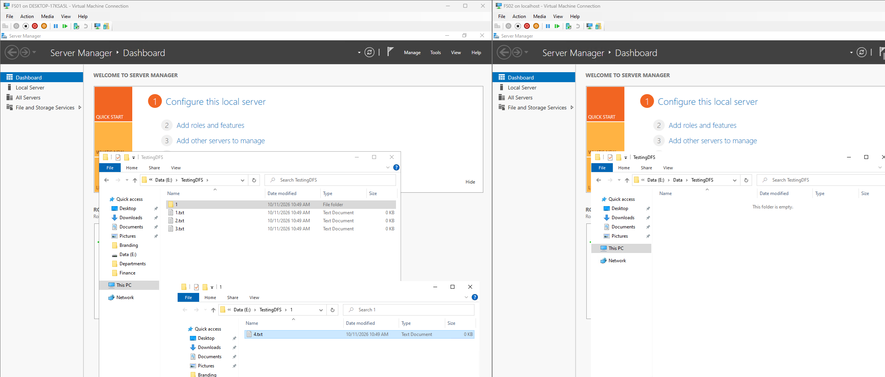
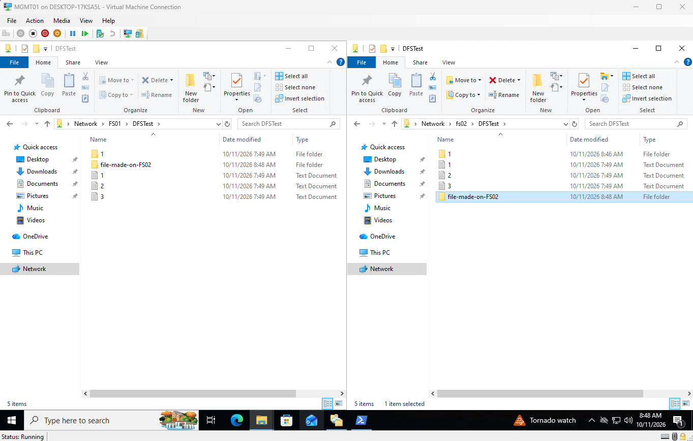
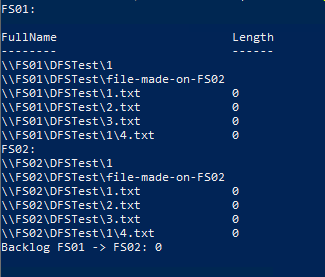
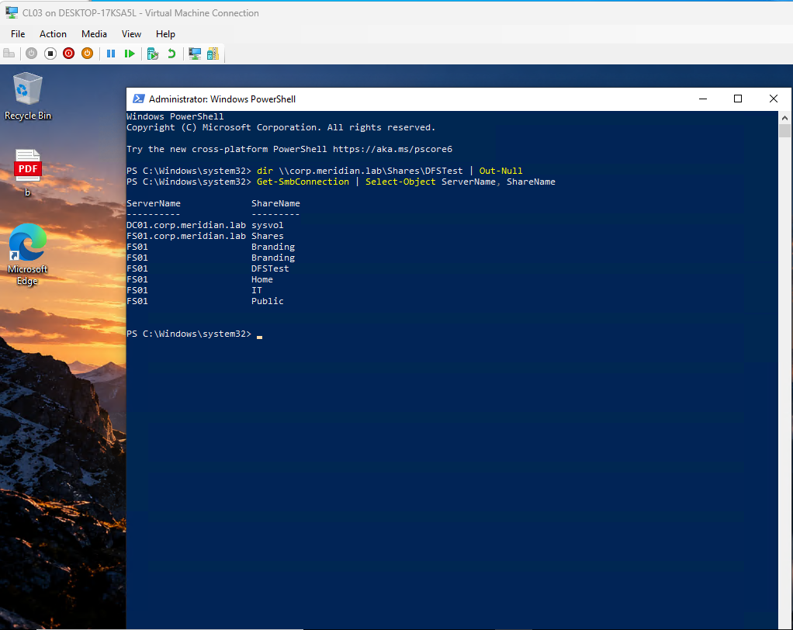
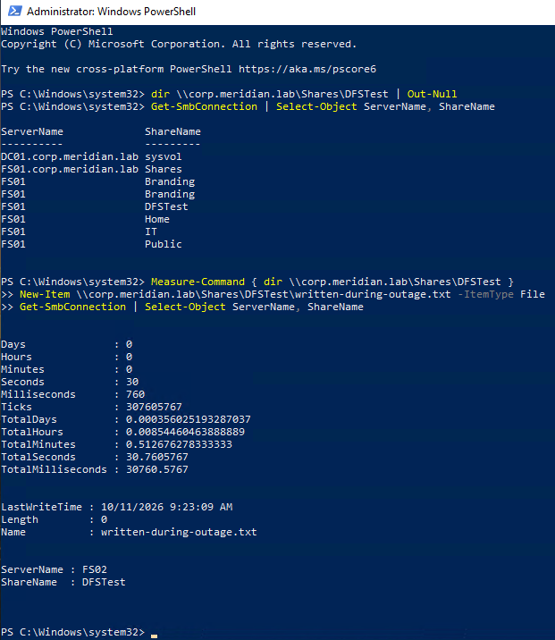
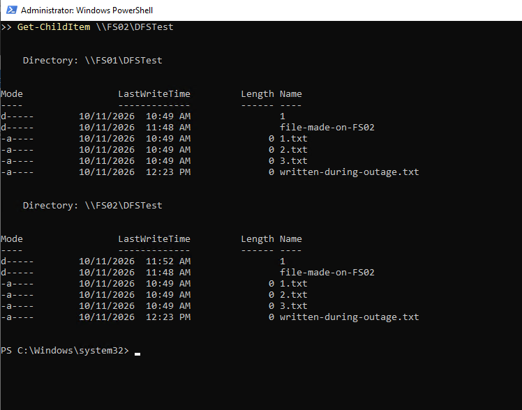

# Phase 12: DFS Replication with a Second File Server

**Date:** 2026-10-11
**Time spent:** 6 Hours
**Status:** Done
**Branch:** phase/12-dfs-replication

## Objective
Add a second file server (FS02) and replicate the file shares to it with DFS Replication, so users keep working through the DFS namespace when FS01 goes down.

## Prerequisites
- File server, DFS namespace, and shares from [Phase 6](06-file-server.md)
- Golden image and clone process from [Phase 2](02-golden-image.md)
- Two domain controllers ([Phase 4](04-dc02-dhcp.md))

## Steps performed
1. Built FS02 from the golden image, gave it `10.10.10.22`, joined it to the domain, and moved it to the `Servers` OU.
2. Installed File Server, File Server Resource Manager, DFS Namespaces, and DFS Replication with **Add Roles and Features**.
3. Added a 100 GB data disk and formatted it as `E:` (label `Data`).
4. **Audited permissions before replicating.** DFSR copies NTFS permissions exactly, so I checked both servers first (see [Findings](#findings), number 1) and cleaned them up.
5. **Tested on a small folder first.** Created `E:\Data\TestingDFS` on both servers, added a few files and a subfolder on FS01, and shared it on both as `DFSTest` with `GG-IT` Modify.

   

   *Figure 1: The test folder on both servers before replication.*

6. Created a replication group in **DFS Management** with FS01 and FS02 as members, a full mesh topology, continuous replication, **FS01 as the primary member**, and `E:\Data\TestingDFS` as the replicated folder.
7. Confirmed the files replicated from FS01 to FS02, then created a folder on FS02 and watched it replicate back to FS01.

   

   *Figure 2: A folder created on FS02 appears on FS01.*

   

   *Figure 3: Command output showing matching files on both servers and a backlog of 0.*

8. Repeated the process for the real data, with one replication group each for **Departments**, **Public**, **Home**, and **Branding** (FS01 primary, FS02 starting empty).
9. **Recreated what does not replicate on FS02:** shares with the same names, access-based enumeration (all but Branding), and share permissions (Domain Admins Full, Authenticated Users Change).
10. **Turned on the file screen on FS02.** Created an active file screen on `E:\Data\Departments` in File Server Resource Manager, using the same file groups as FS01 (executables, audio, and video).
11. **Added FS02 as a second folder target and namespace server** on each existing namespace link.
12. Set FS01 as the first-choice target for `Home`, so two servers are not written to at once.
13. Changed every user's home folder path from `\\FS01\Home\<user>` to `\\corp.meridian.lab\Shares\Home\<user>` in Active Directory Users and Computers, so `H:` fails over.
14. Enabled shadow copies on FS02's `E:` with the same schedule as FS01.

## Verification
1. **Failover test.** From CL03, I opened a path through the namespace and used `Get-SmbConnection` to see which server answered. It was FS01. I then powered FS01 off (a hard power-off) and timed the next access.

   

   *Figure 4: Before the outage, CL03 is connected to FS01.*

   

   *Figure 5: With FS01 off, the path opened in about 31 seconds and the client moved to FS02. A file created during the outage was written to FS02.*

2. **With FS01 off,** the lock screen, wallpaper, department shares, public share, and home folders all kept working for users.
3. **Recovery.** After FS01 restarted, the file written during the outage replicated back, and both servers matched.

   

   *Figure 6: Both servers list the file created while FS01 was down.*

## Findings
1. **The permissions audit found problems on both servers.** My personal admin account was on most data folders, default `BUILTIN\Users` entries were on `E:\Data`, folder owners were my personal account, and the new `DFSTest` shares had only the default `Everyone: Read`. Every folder had been created while signed in as my own admin account, and inheritance copied that entry downward. I fixed each at its source folder, granted access through groups instead, and re-ran the audit before replicating, because DFSR would have copied the mistakes to FS02.
2. **NTFS permissions replicate, but shares do not.** Folder contents and ACLs (including the `DL-` group entries) arrive on FS02 automatically. Shares, share permissions, FSRM quotas and file screens, shadow copy settings, and namespace folder targets must be created by hand on each server.
3. **Windows Explorer's "Continue" prompt re-added my account to an ACL.** Admin group membership is filtered in a normal session, so Explorer offers to add the account to the folder permanently. Clicking it undid my cleanup, and it replicated to FS02. I now use elevated tools or the network path for these folders.
4. **A powered-off PDC emulator broke DFS management.** All five FSMO roles were still on DC02 after the Phase 11 drill. With DC02 off, DFS cmdlets failed with error 58, and the namespace could not be enumerated. Moving the PDC emulator to DC01 fixed it.
5. **Failover took about 31 seconds** with default settings. 
6. **Quotas exist on FS01 only.** FSRM quotas and file screens do not replicate, so each has to be created by hand on every server. I recreated the file screen on FS02, but I left quotas off FS02. After a failover, users are not limited by quota until FS01 returns. A smaller quota on the secondary could also block replicated files, so I did not add one. In production I would recreate quotas on both servers and verify with a compare script.
7. **A hard power-off caused a short burst of DFSR events.** Warnings 5014 and errors 5002 appeared as the partner connection dropped, followed by one service stop (1006), a start (1002, 1004), and a database recovery (6102), with no dirty-shutdown pause (2213).

## What I learned
- DFS Namespaces and DFS Replication are separate. The namespace gives users one stable path, and replication keeps the data identical behind it.
- Replication copies mistakes as faithfully as good data, so I audit and clean the primary before creating the group.
- Users and GPOs should use only the namespace path. Anything written as `\\FS01\...` bypasses it and breaks when FS01 is down.
- Distributed file access has no cross-server locking, which is why the home folder has a preferred first target.

## Related files
- [Permissions matrix](evidence/permissions-matrix.md)
- [IP plan](../overview/ip-plan.md)