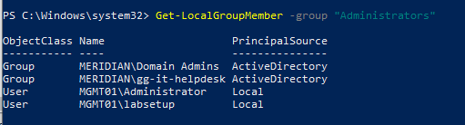

# Problem: Group Policy Preference reports Success but does not add the helpdesk group to local Administrators

**Date:** 10-10-2026
**Type:** Unplanned issue found during testing

## Symptom
The `Helpdesk Local Admin` GPO is supposed to add `MERIDIAN\GG-IT-Helpdesk` to the built-in
Administrators group on every department PC. On MGMT01, the group was missing:

```text
PS> Get-LocalGroupMember -Group "Administrators"

ObjectClass Name                    PrincipalSource
----------- ----                    ---------------
Group       MERIDIAN\Domain Admins  ActiveDirectory
User        MGMT01\Administrator    Local
User        MGMT01\labsetup         Local
```

The Group Policy report, however, showed the item as successful.

## Troubleshooting steps
1. **Confirmed the policy applied.** `gpresult /r /scope computer` listed the GPO under
   Applied Group Policy Objects, and the HTML report showed **Result: Success** for the
   Administrators item, with the helpdesk group listed under Add members.
2. **Refreshed policy.** Ran `gpupdate /force` and let it finish. One earlier run had been
   cancelled partway, so it was repeated. The group was still missing.
3. **Restarted the computer.** Local group preferences apply reliably at startup. The group
   was still missing after the reboot.
4. **Checked the report was current.** The first report was stale. After regenerating it,
   the result was still Success, and the group was still missing.
5. **Checked the event log.** Filtering the Application log for Group Policy Local Users and
   Groups returned no events, so there was no error to read.
6. **Tested the machine by hand.** `Add-LocalGroupMember -Group "Administrators" -Member
   "MERIDIAN\GG-IT-Helpdesk"` worked, which showed the computer could resolve and use the
   group. The fault was therefore in the policy item and not in name resolution.
7. **Removed the manual entry and refreshed again.** After `gpupdate /force`, the group was
   still not added, so the policy item was doing nothing.
8. **Reviewed the item's settings.** The Common tab had no unusual options: no item-level
   targeting, "Apply once" off, and no removal option set. The Action was Update, and
   neither delete option was enabled.
9. **Remembered how the item was created.** I had typed `Administrators (built-in)` into the
   Group name field instead of selecting it from the dropdown.

## Cause
Most likely, the typed group name was not matched to the built-in Administrators group.
The item reported Success, but it did not change the group. I did not capture a trace
showing why, so this is inferred from the result: re-creating the item with the dropdown
fixed it.

## Fix
Deleted the item and created it again:
1. **Computer Configuration, Preferences, Control Panel Settings, Local Users and Groups,
   New, Local Group**
2. **Action:** Update
3. **Group name:** selected **Administrators (built-in)** from the dropdown
4. **Members:** added `GG-IT-Helpdesk` with the object picker, not typed
5. Ran `gpupdate /force`, restarted, and rechecked the group.

## How I verified
```powershell
Get-LocalGroupMember -Group "Administrators"
```



*Figure 1: The helpdesk group appears in the local Administrators group.*

## How to prevent it
- In Group Policy Preferences, select groups and accounts with the dropdowns and object
  pickers instead of typing them.
- Verify the result on the computer. A "Success" in the Group Policy report only means the
  item was processed, and it does not prove the setting was applied.
- Test a change by hand first, then remove it, so the policy's effect is not hidden.

## What I learned
- A successful Group Policy result is not proof that the change happened, so I check the
  machine's real state.
- Adding the group by hand separated two possible causes: the computer being unable to use
  the group, or the policy item failing.